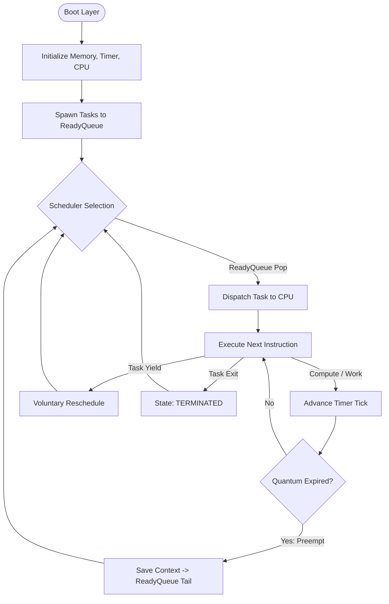
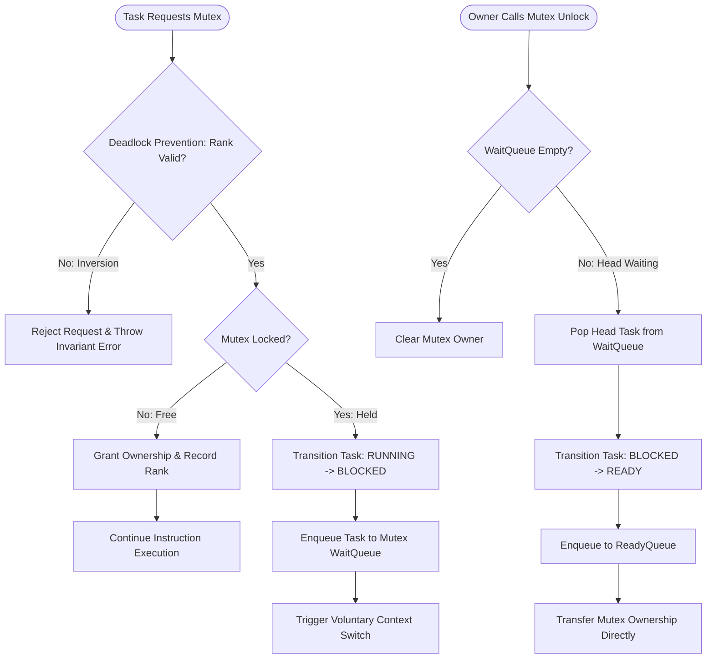

# Micro-OS Architecture Specification
## CA-6: Operating Systems – Systems Construction

---

## 1. Architectural Overview

Micro-OS is designed in accordance with the educational philosophy of CA-6: **"Do not build a large operating system. Build a small operating system that makes OS mechanisms visible."**

It follows a modular, layered systems architecture where each level of abstraction builds strictly upon the mechanisms provided below it.

```text
+-----------------------------------------------------------------------+
|                    Layer 10: Micro-OS Demonstration                   |
|       (Integrated Workloads, Multi-tasking, Concurrency Validation)   |
+-----------------------------------------------------------------------+
                                   |
                                   v
+-----------------------------------------------------------------------+
|                 Layer 9: System Call / Kernel Interface               |
|      (Syscall Dispatch: Yield, Sleep, Lock, Unlock, Alloc, Exit)      |
+-----------------------------------------------------------------------+
                                   |
         +-------------------------+-------------------------+
         |                                                   |
         v                                                   v
+-----------------------------------+   +-------------------------------+
|  Layer 7: Synchronization         |   | Layer 8: Memory Subsystem     |
|  - Test-and-Set Spinlock          |   | - Bump Allocator (Fast Heap)  |
|  - Fair Ticket Spinlock           |   | - Fixed-Size Block Allocator  |
|  - Sleeping Mutex (Wait Queue)    |   | - Free-List Recycling Pool    |
|  - Deadlock Prevention (Rankings) |   | - Fragmentation & OOM Monitor |
+-----------------------------------+   +-------------------------------+
         |                                                   |
         +-------------------------+-------------------------+
                                   |
                                   v
+-----------------------------------------------------------------------+
|            Layer 4 & 5: Task Management & CPU Scheduling              |
|  - Task Control Block (TCB: State, Context, Virtual Stack, Metrics)   |
|  - FIFO Ready Queue & Mutex Wait Queues                               |
|  - Preemptive Round Robin Scheduler (Time-slice Quantum Tracking)     |
+-----------------------------------------------------------------------+
                                   |
                                   v
+-----------------------------------------------------------------------+
|               Layer 6: Virtual Timer & Interrupt Layer                |
|       (Periodic Tick Generation, Quantum Expiration Preemption)       |
+-----------------------------------------------------------------------+
                                   |
                                   v
+-----------------------------------------------------------------------+
|            Layer 2: Kernel Diagnostics, Console & Tracing             |
|   (Structured Logging, ANSI Color Levels, JSON/CSV Trace Exporters)   |
+-----------------------------------------------------------------------+
                                   |
                                   v
+-----------------------------------------------------------------------+
|            Layer 1: Boot, Hardware Abstraction & CPU Context          |
|      (Register Bank r0..r7, PC, SP, Flags, Virtual Address Space)     |
+-----------------------------------------------------------------------+
```

---

## 2. Component Data and Control Flow

### A. Task Execution and Preemption Flow


### B. Specialization Track C: Mutex Locking & Sleeping Wait Queue Flow


---

## 3. Layer Specifications

### Layer 1: Hardware Abstraction & Boot
- **Virtual CPU**: Defines `CpuContext` containing 8 general-purpose 64-bit registers (`r0..r7`), program counter `pc`, stack pointer `sp`, and status flags `flags`.
- **Boot Sequence**: `BootManager` drives deterministic state transitions from `PowerOn -> InitializingConsole -> InitializingMemory -> InitializingInterrupts -> InitializingScheduler -> KernelOperational`.

### Layer 2: Console & Diagnostics
- **Structured Logging**: Timestamped logging with explicit subsystems (`BOOT`, `SCHED`, `SYNC`, `MEM`, `TASK`).
- **Telemetry Export**: Dual output to stdout (ANSI colored) and formatted trace logs (CSV/JSONL) for Python offline analysis.

### Layer 3 & 4: Task Representation & Ready Queue
- **Task Control Block (TCB)**: Encapsulates task identity (`TaskId`), lifecycle state (`Ready`, `Running`, `Blocked`, `Terminated`), context registers, virtual stack limits, and execution metrics.
- **Ready Queue**: Double-ended FIFO queue providing $O(1)$ dispatch and enqueuing.

### Layer 5 & 6: Round Robin Scheduler & Timer
- **Quantum Management**: Configurable time quantum (default = 2 ticks).
- **Preemption**: Ticks decrement quantum remaining; upon exhaustion, the running task is preempted and returned to the tail of the `ReadyQueue`.

### Layer 7: Specialization Track C (Concurrency Engineering)
- **Spinlock**: Test-and-set spinlock with exponential backoff and spin-cycle measurement.
- **Fair Ticket Spinlock**: FIFO ticket assignment (`next_ticket`, `now_serving`) guaranteeing zero starvation.
- **Sleeping Mutex**: Blocking synchronization where contended tasks yield CPU and wait in a dedicated queue.
- **Deadlock Prevention**: Strict hierarchical lock ranking enforcing Dijkstra's resource ordering to eliminate circular wait.

### Layer 8: Memory Subsystem
- **Bump Allocator**: Linear pointer-advancing allocator for rapid initialization buffers.
- **Block Allocator**: Fixed 64-byte block pool with free-list recycling, eliminating external fragmentation.
